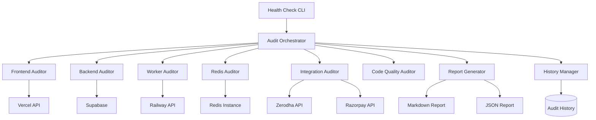
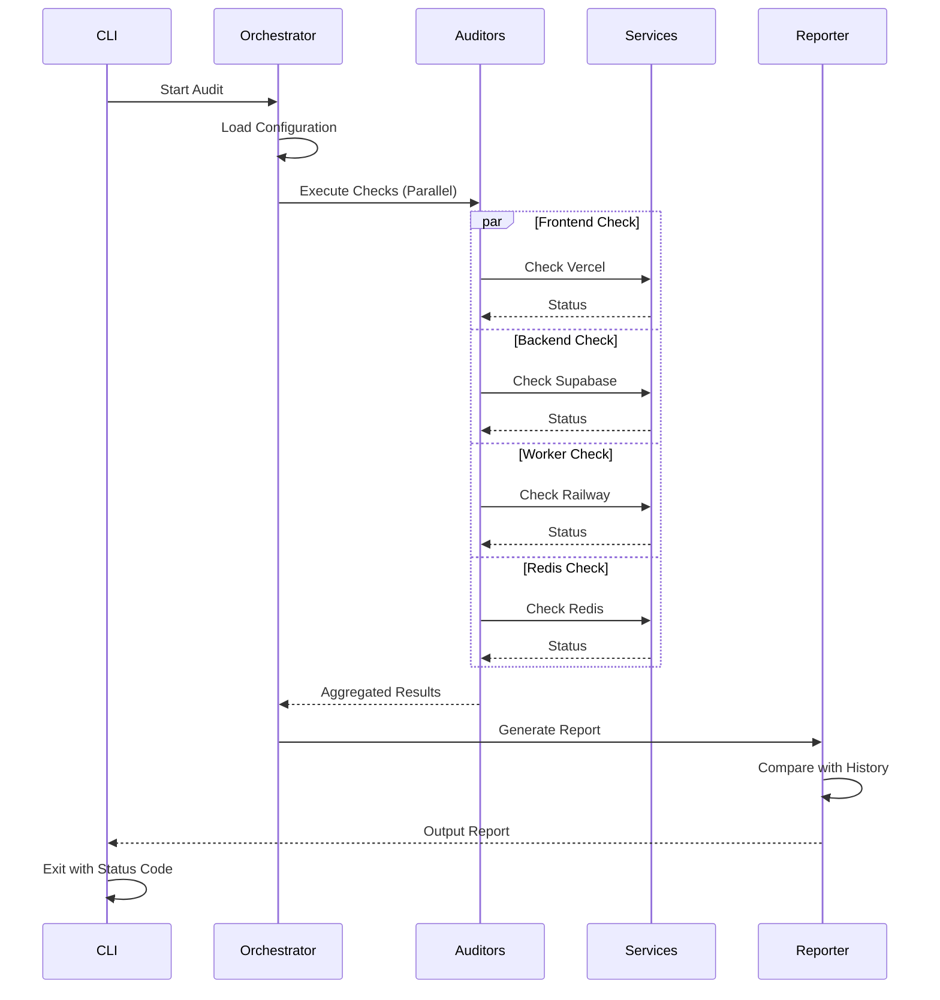

# Design Document: System Health Audit and Connectivity

## Overview

The System Health Audit and Connectivity feature provides comprehensive monitoring and verification capabilities for the AiRA trading platform. It audits all critical components (Vercel frontend, Supabase backend, Railway workers, Redis cache, and external integrations), verifies connectivity between services, identifies broken functionality, and generates detailed reports with prioritized fix recommendations.

The system is designed as a standalone CLI tool with both interactive and automated modes, supporting continuous monitoring through scheduled execution. It produces both human-readable markdown reports and machine-readable JSON output for integration with CI/CD pipelines and alerting systems.

### Key Design Principles

1. **Non-Invasive**: Health checks should not modify system state or interfere with production operations
2. **Parallel Execution**: Independent checks run concurrently to minimize total execution time
3. **Graceful Degradation**: Failure of one check should not prevent other checks from running
4. **Actionable Output**: Reports include specific fix recommendations and severity classifications
5. **Historical Tracking**: Store audit results for trend analysis and regression detection

## Architecture

### Component Diagram



### Execution Flow



## Components and Interfaces

### 1. Audit Orchestrator

The central coordinator that manages the execution of all health checks and aggregates results.

**Interface:**
```typescript
interface AuditOrchestrator {
  /**
   * Execute all configured health checks
   * @param config - Audit configuration options
   * @returns Aggregated audit results
   */
  runAudit(config: AuditConfig): Promise<AuditResult>;
  
  /**
   * Execute specific category of checks
   * @param category - Category to audit (frontend, backend, workers, etc.)
   * @returns Category-specific results
   */
  runCategory(category: AuditCategory): Promise<CategoryResult>;
}

interface AuditConfig {
  environment: 'development' | 'staging' | 'production';
  parallel: boolean;
  timeout: number; // milliseconds
  categories: AuditCategory[];
  verbose: boolean;
}

type AuditCategory = 
  | 'frontend' 
  | 'backend' 
  | 'workers' 
  | 'redis' 
  | 'integrations' 
  | 'code-quality';

interface AuditResult {
  timestamp: string;
  environment: string;
  duration: number; // milliseconds
  overallHealth: HealthStatus;
  categories: Record<AuditCategory, CategoryResult>;
  issues: Issue[];
  summary: AuditSummary;
}

type HealthStatus = 'healthy' | 'degraded' | 'critical' | 'unknown';

interface CategoryResult {
  status: HealthStatus;
  checks: CheckResult[];
  duration: number;
}

interface CheckResult {
  name: string;
  status: 'pass' | 'fail' | 'warn' | 'skip';
  message: string;
  details?: Record<string, any>;
  error?: string;
  duration: number;
}
```

### 2. Frontend Auditor

Verifies the health of the Next.js application deployed on Vercel.

**Interface:**
```typescript
interface FrontendAuditor {
  /**
   * Check Vercel deployment status
   */
  checkDeploymentStatus(): Promise<CheckResult>;
  
  /**
   * Verify API routes are accessible and functional
   */
  checkAPIRoutes(): Promise<CheckResult>;
  
  /**
   * Test critical page routes
   */
  checkPageAccessibility(): Promise<CheckResult>;
  
  /**
   * Verify build configuration
   */
  checkBuildConfig(): Promise<CheckResult>;
}

interface DeploymentInfo {
  id: string;
  state: 'READY' | 'ERROR' | 'BUILDING' | 'QUEUED' | 'CANCELED';
  url: string;
  createdAt: string;
  buildTime: number;
  errors: string[];
}

interface APIRouteCheck {
  path: string;
  method: string;
  expectedStatus: number;
  actualStatus?: number;
  responseTime?: number;
  error?: string;
}
```

**Implementation Strategy:**
- Use Vercel API to fetch deployment information
- Test critical API endpoints with HTTP requests
- Verify environment variables are set correctly
- Check for build errors in deployment logs

### 3. Backend Auditor

Verifies Supabase database connectivity, authentication, and schema integrity.

**Interface:**
```typescript
interface BackendAuditor {
  /**
   * Test database connectivity
   */
  checkDatabaseConnection(): Promise<CheckResult>;
  
  /**
   * Verify authentication system
   */
  checkAuthSystem(): Promise<CheckResult>;
  
  /**
   * Validate RLS policies
   */
  checkRLSPolicies(): Promise<CheckResult>;
  
  /**
   * Verify table schemas
   */
  checkTableSchemas(): Promise<CheckResult>;
}

interface DatabaseConnectionInfo {
  connected: boolean;
  latency: number; // milliseconds
  version: string;
  poolSize?: number;
}

interface RLSPolicyCheck {
  tableName: string;
  hasRLS: boolean;
  policies: PolicyInfo[];
  issues: string[];
}

interface PolicyInfo {
  name: string;
  command: 'SELECT' | 'INSERT' | 'UPDATE' | 'DELETE' | 'ALL';
  roles: string[];
  using: string;
}

interface TableSchemaCheck {
  tableName: string;
  exists: boolean;
  expectedColumns: string[];
  actualColumns: string[];
  missingColumns: string[];
  extraColumns: string[];
}
```

**Implementation Strategy:**
- Use Supabase client to execute test queries
- Query `pg_policies` to verify RLS configuration
- Query `information_schema` to validate table structures
- Test both anon key and service role connections

### 4. Worker Auditor

Verifies Railway worker services are running and healthy.

**Interface:**
```typescript
interface WorkerAuditor {
  /**
   * Check all Railway services status
   */
  checkServicesStatus(): Promise<CheckResult>;
  
  /**
   * Verify environment variables
   */
  checkEnvironmentVariables(): Promise<CheckResult>;
  
  /**
   * Analyze recent logs for errors
   */
  checkServiceLogs(): Promise<CheckResult>;
  
  /**
   * Test worker health endpoints (if available)
   */
  checkHealthEndpoints(): Promise<CheckResult>;
}

interface RailwayServiceInfo {
  name: string;
  status: 'running' | 'crashed' | 'stopped' | 'deploying';
  replicas: number;
  lastDeployment: string;
  restartCount: number;
  uptime: number; // seconds
}

interface EnvironmentVariableCheck {
  serviceName: string;
  requiredVars: string[];
  missingVars: string[];
  presentVars: string[];
}

interface LogAnalysis {
  serviceName: string;
  errorCount: number;
  warningCount: number;
  recentErrors: LogEntry[];
  patterns: ErrorPattern[];
}

interface LogEntry {
  timestamp: string;
  level: 'error' | 'warn' | 'info';
  message: string;
}

interface ErrorPattern {
  pattern: string;
  count: number;
  firstSeen: string;
  lastSeen: string;
}
```

**Implementation Strategy:**
- Use Railway CLI or API to fetch service status
- Parse `railway.json` to identify required services
- Analyze logs using pattern matching for common errors
- Verify critical environment variables are set

### 5. Redis Auditor

Verifies Redis connectivity and operational status.

**Interface:**
```typescript
interface RedisAuditor {
  /**
   * Test Redis connection
   */
  checkConnection(): Promise<CheckResult>;
  
  /**
   * Verify read/write operations
   */
  checkOperations(): Promise<CheckResult>;
  
  /**
   * Get Redis server info
   */
  checkServerInfo(): Promise<CheckResult>;
}

interface RedisConnectionInfo {
  connected: boolean;
  host: string;
  port: number;
  latency: number; // milliseconds
  version: string;
}

interface RedisOperationCheck {
  canRead: boolean;
  canWrite: boolean;
  canDelete: boolean;
  testKey: string;
  error?: string;
}

interface RedisServerInfo {
  version: string;
  uptime: number; // seconds
  connectedClients: number;
  usedMemory: number; // bytes
  maxMemory: number; // bytes
  memoryUsagePercent: number;
}
```

**Implementation Strategy:**
- Use ioredis client to connect to Redis
- Perform test SET/GET/DEL operations with unique keys
- Query INFO command for server statistics
- Verify REDIS_URL environment variable

### 6. Integration Auditor

Verifies external service integrations (Zerodha, Razorpay).

**Interface:**
```typescript
interface IntegrationAuditor {
  /**
   * Check Zerodha broker integration
   */
  checkZerodhaIntegration(): Promise<CheckResult>;
  
  /**
   * Check Razorpay payment integration
   */
  checkRazorpayIntegration(): Promise<CheckResult>;
}

interface ZerodhaIntegrationCheck {
  credentialsConfigured: boolean;
  apiAccessible: boolean;
  authenticationWorks: boolean;
  marketDataAvailable: boolean;
  error?: string;
}

interface RazorpayIntegrationCheck {
  credentialsConfigured: boolean;
  apiAccessible: boolean;
  error?: string;
}
```

**Implementation Strategy:**
- Verify API credentials are present in environment
- Test authentication without making actual trades
- Fetch market status or instrument list to verify connectivity
- Use test mode for Razorpay verification

### 7. Code Quality Auditor

Verifies code quality, security configuration, and build health.

**Interface:**
```typescript
interface CodeQualityAuditor {
  /**
   * Run ESLint checks
   */
  checkLinting(): Promise<CheckResult>;
  
  /**
   * Verify TypeScript compilation
   */
  checkTypeScript(): Promise<CheckResult>;
  
  /**
   * Verify security headers
   */
  checkSecurityConfig(): Promise<CheckResult>;
  
  /**
   * Verify encryption configuration
   */
  checkEncryption(): Promise<CheckResult>;
}

interface LintingResult {
  errorCount: number;
  warningCount: number;
  files: number;
  issues: LintIssue[];
}

interface LintIssue {
  file: string;
  line: number;
  column: number;
  severity: 'error' | 'warning';
  rule: string;
  message: string;
}

interface TypeScriptCheck {
  compiles: boolean;
  errors: TypeScriptError[];
}

interface TypeScriptError {
  file: string;
  line: number;
  message: string;
}

interface SecurityConfigCheck {
  hasHSTS: boolean;
  hasXFrameOptions: boolean;
  hasCSP: boolean;
  middlewareProtection: boolean;
  issues: string[];
}

interface EncryptionCheck {
  keyConfigured: boolean;
  keyLength: number;
  expectedLength: number;
  isValid: boolean;
}
```

**Implementation Strategy:**
- Execute ESLint programmatically
- Run TypeScript compiler in check mode
- Parse `next.config.ts` for security headers
- Verify ENCRYPTION_KEY format and length

### 8. Report Generator

Generates human-readable and machine-readable audit reports.

**Interface:**
```typescript
interface ReportGenerator {
  /**
   * Generate markdown report
   */
  generateMarkdown(result: AuditResult, comparison?: AuditComparison): string;
  
  /**
   * Generate JSON report
   */
  generateJSON(result: AuditResult): string;
  
  /**
   * Generate summary for CLI output
   */
  generateSummary(result: AuditResult): string;
}

interface AuditComparison {
  previousAudit: AuditResult;
  newIssues: Issue[];
  resolvedIssues: Issue[];
  persistentIssues: Issue[];
}

interface Issue {
  id: string;
  category: AuditCategory;
  component: string;
  severity: 'critical' | 'high' | 'medium' | 'low';
  title: string;
  description: string;
  recommendation: string;
  firstSeen: string;
  lastSeen: string;
}

interface AuditSummary {
  totalChecks: number;
  passedChecks: number;
  failedChecks: number;
  warnings: number;
  skippedChecks: number;
  criticalIssues: number;
  highIssues: number;
  mediumIssues: number;
  lowIssues: number;
  healthScore: number; // 0-100
}
```

**Report Format:**
```markdown
# System Health Audit Report
**Date:** 2026-02-09 14:30:00 UTC
**Environment:** Production
**Duration:** 45.2s
**Overall Health:** Degraded
**Health Score:** 72/100

## Executive Summary
- Total Checks: 45
- Passed: 38
- Failed: 5
- Warnings: 2
- Critical Issues: 1
- High Issues: 2

## Issues by Severity

### Critical Issues (1)
1. **Redis Service Not Running**
   - Component: Redis Cache
   - Description: Redis connection failed - ECONNREFUSED
   - Impact: Trading engine cannot acquire distributed locks
   - Recommendation: Add Redis service to Railway project using `railway add`

### High Issues (2)
1. **Zerodha Authentication Failed**
   - Component: Zerodha Integration
   - Description: API credentials invalid or expired
   - Impact: Cannot execute trades or fetch market data
   - Recommendation: Regenerate API credentials in Zerodha console

[... detailed sections for each category ...]

## Changes Since Last Audit (2026-02-08)
- **New Issues:** 2
- **Resolved Issues:** 1
- **Persistent Issues:** 3

### New Issues
- Redis Service Not Running (Critical)
- Market Data Worker High Memory Usage (Medium)

### Resolved Issues
- Frontend Build Warnings (Low)
```

### 9. History Manager

Manages storage and retrieval of historical audit results.

**Interface:**
```typescript
interface HistoryManager {
  /**
   * Save audit result to history
   */
  saveAudit(result: AuditResult): Promise<void>;
  
  /**
   * Get most recent audit
   */
  getLatestAudit(): Promise<AuditResult | null>;
  
  /**
   * Get audit by timestamp
   */
  getAuditByTimestamp(timestamp: string): Promise<AuditResult | null>;
  
  /**
   * List all audits
   */
  listAudits(limit?: number): Promise<AuditMetadata[]>;
  
  /**
   * Compare two audits
   */
  compareAudits(timestamp1: string, timestamp2: string): Promise<AuditComparison>;
}

interface AuditMetadata {
  timestamp: string;
  environment: string;
  overallHealth: HealthStatus;
  issueCount: number;
  duration: number;
}
```

**Storage Strategy:**
- Store audit results as JSON files in `.kiro/audit-history/`
- Filename format: `audit-{environment}-{timestamp}.json`
- Keep last 30 audits per environment
- Implement cleanup of old audits

### 10. CLI Interface

Command-line interface for running audits and viewing results.

**Commands:**
```bash
# Run full audit
npm run health-check

# Run specific category
npm run health-check -- --category=backend

# Run in specific environment
npm run health-check -- --env=production

# Output JSON only
npm run health-check -- --json

# Verbose output
npm run health-check -- --verbose

# Compare with previous audit
npm run health-check -- --compare

# List audit history
npm run health-check -- --history

# View specific audit
npm run health-check -- --view=2026-02-09T14:30:00Z
```

**Exit Codes:**
- 0: All checks passed (healthy)
- 1: Warnings present (degraded)
- 2: Critical issues found (critical)
- 3: Audit execution failed (unknown)

## Data Models

### Configuration File

Location: `.kiro/health-check-config.json`

```typescript
interface HealthCheckConfig {
  version: string;
  environments: {
    [env: string]: EnvironmentConfig;
  };
  checks: {
    [category: string]: CategoryConfig;
  };
  thresholds: HealthThresholds;
  notifications: NotificationConfig;
}

interface EnvironmentConfig {
  vercelProjectId?: string;
  railwayProjectId?: string;
  supabaseProjectRef?: string;
  redisUrl?: string;
}

interface CategoryConfig {
  enabled: boolean;
  timeout: number;
  checks: string[];
}

interface HealthThresholds {
  healthyMinScore: number; // 90
  degradedMinScore: number; // 70
  criticalMaxIssues: number; // 0
  highMaxIssues: number; // 2
}

interface NotificationConfig {
  enabled: boolean;
  channels: ('email' | 'slack' | 'webhook')[];
  onCritical: boolean;
  onDegraded: boolean;
}
```

### Audit Result Storage

Location: `.kiro/audit-history/audit-{env}-{timestamp}.json`

```typescript
interface StoredAuditResult extends AuditResult {
  version: string; // Schema version for future compatibility
  config: AuditConfig;
  metadata: {
    hostname: string;
    user: string;
    nodeVersion: string;
    platform: string;
  };
}
```


## Correctness Properties

*A property is a characteristic or behavior that should hold true across all valid executions of a system—essentially, a formal statement about what the system should do. Properties serve as the bridge between human-readable specifications and machine-verifiable correctness guarantees.*

### Property 1: Information Retrieval Completeness

*For any* configured service (Vercel, Supabase, Railway, Redis, Zerodha, Razorpay), when the Health_Auditor retrieves status information, the returned data structure should contain all expected fields defined in the corresponding interface (DeploymentInfo, DatabaseConnectionInfo, RailwayServiceInfo, etc.).

**Validates: Requirements 1.1, 2.1, 3.1, 4.1, 4.5, 5.1**

### Property 2: Endpoint Verification Correctness

*For any* collection of API endpoints with expected status codes, when the Health_Auditor tests them, the verification result should correctly classify each endpoint as passing (actual status matches expected) or failing (actual status differs from expected).

**Validates: Requirements 1.2, 1.4, 5.2, 9.3**

### Property 3: Schema Validation Accuracy

*For any* table schema with expected columns, when the Health_Auditor validates it, the checker should correctly identify all missing columns (expected but not present) and extra columns (present but not expected), with no false positives or false negatives.

**Validates: Requirements 2.4**

### Property 4: RLS Policy Validation

*For any* database table, when the Health_Auditor validates RLS policies, the checker should correctly identify whether RLS is enabled and report all configured policies with their commands and roles.

**Validates: Requirements 2.3**

### Property 5: Authentication Verification

*For any* set of authentication credentials (Supabase anon key, service role key, Zerodha API credentials), when the Health_Auditor tests them, the checker should correctly identify which credentials are functional and which are not, distinguishing between missing credentials, invalid credentials, and valid credentials.

**Validates: Requirements 2.2, 5.1**

### Property 6: Service State Classification

*For any* Railway service with a deployment state, when the Health_Auditor checks its status, the checker should correctly classify the service as running, crashed, stopped, or deploying based on the actual state.

**Validates: Requirements 3.2**

### Property 7: Log Pattern Detection

*For any* collection of log entries, when the Health_Auditor analyzes them, the analyzer should correctly identify and count error patterns, with each unique pattern counted accurately and no duplicate patterns reported.

**Validates: Requirements 3.3**

### Property 8: Configuration Validation Completeness

*For any* service with required configuration values (environment variables, API keys, encryption keys), when the Health_Auditor validates configuration, the validator should correctly identify all missing required values and verify that present values meet format requirements (e.g., ENCRYPTION_KEY is exactly 64 hex characters).

**Validates: Requirements 3.4, 5.3, 6.4, 8.5**

### Property 9: Redis Operation Verification

*For any* Redis connection, when the Connectivity_Verifier tests operations, the verifier should correctly determine whether SET, GET, and DELETE operations succeed or fail, with test operations using unique keys that don't interfere with production data.

**Validates: Requirements 4.2**

### Property 10: Error Severity Classification

*For any* detected issue (deployment error, connectivity failure, missing configuration, service crash), when the Health_Auditor classifies it, the classification should match the defined severity rules: Critical for Redis unavailability and service crashes, High for authentication failures, Medium for missing payment credentials, Low for linting warnings.

**Validates: Requirements 1.5, 2.5, 3.5, 4.4, 5.4, 5.5**

### Property 11: Security Configuration Validation

*For any* Next.js configuration file, when the Health_Auditor validates security headers, the validator should correctly identify the presence or absence of HSTS, X-Frame-Options, and CSP headers by parsing the configuration structure.

**Validates: Requirements 6.3**

### Property 12: Code Quality Metrics Accuracy

*For any* ESLint execution result, when the Health_Auditor reports linting metrics, the reported error count and warning count should exactly match the counts in the ESLint output.

**Validates: Requirements 6.1**

### Property 13: Middleware Protection Verification

*For any* middleware configuration, when the Health_Auditor validates route protection, the validator should correctly identify which admin and cron routes have authentication checks and which do not.

**Validates: Requirements 6.5**

### Property 14: Report Completeness

*For any* audit execution with N check results, when the Report Generator creates an Audit_Report, the report should include results from all N checks organized by category, with no checks omitted.

**Validates: Requirements 7.1**

### Property 15: Issue Organization by Severity

*For any* collection of issues with different severity levels, when the Report Generator organizes them, all Critical issues should appear before High issues, all High issues before Medium issues, and all Medium issues before Low issues, maintaining severity-based ordering.

**Validates: Requirements 7.2**

### Property 16: Issue Field Completeness

*For any* issue included in an Audit_Report, the issue should contain all required fields: component name, description, severity, and recommendation, with no fields missing or empty.

**Validates: Requirements 7.3**

### Property 17: Summary Calculation Accuracy

*For any* audit result with check outcomes, when the Report Generator calculates the summary, the total check count should equal the sum of passed, failed, warned, and skipped checks, and the issue count by severity should equal the total number of issues.

**Validates: Requirements 7.4**

### Property 18: Report Persistence with Comparison

*For any* generated Audit_Report, when saved to disk, the file should be written with a timestamp in the filename, and if a previous audit exists, the report should include a comparison section identifying new, resolved, and persistent issues.

**Validates: Requirements 7.5, 10.5**

### Property 19: Parallel Execution Efficiency

*For any* set of independent health checks (checks that don't depend on each other's results), when the Health_Check_Script executes them in parallel, the total execution time should be less than or equal to the execution time of the slowest individual check plus overhead, and significantly less than the sum of all check execution times.

**Validates: Requirements 8.2**

### Property 20: Output Format Validity

*For any* audit result, when the Health_Check_Script outputs it, both the markdown output should be valid markdown syntax and the JSON output should be valid JSON that can be parsed without errors.

**Validates: Requirements 8.3**

### Property 21: Exit Code Correctness

*For any* audit result, when the Health_Check_Script completes, the exit code should be 0 if no issues exist, 1 if only warnings exist, 2 if critical issues exist, and 3 if the audit execution itself failed.

**Validates: Requirements 8.4**

### Property 22: Response Time Threshold Detection

*For any* endpoint with a response time and a defined threshold, when the Connectivity_Verifier tests it, the verifier should correctly identify whether the response time exceeds the threshold (>2000ms for database, >5000ms for external APIs).

**Validates: Requirements 9.2**

### Property 23: Error Type Classification

*For any* connectivity test failure, when the Connectivity_Verifier analyzes the error, the verifier should correctly classify it as one of: network error (connection refused, timeout), authentication error (401, 403), or timeout error (request exceeded time limit), with no ambiguous classifications.

**Validates: Requirements 9.4**

### Property 24: Connectivity Matrix Completeness

*For any* connectivity test suite execution with N services, when the Connectivity_Verifier generates a connectivity matrix, the matrix should contain N×M entries where M is the number of target services, with each service-to-service connection represented exactly once.

**Validates: Requirements 9.5**

### Property 25: Audit Comparison Accuracy

*For any* two audit results (previous and current), when the History Manager compares them, the union of new issues, resolved issues, and persistent issues should equal the union of all issues from both audits, with no issue appearing in multiple categories.

**Validates: Requirements 10.2, 10.3, 10.4**

### Property 26: Historical Storage with Timestamp

*For any* audit result, when the History Manager stores it, the stored file should have a filename containing the environment and timestamp, and retrieving the audit by that timestamp should return an equivalent audit result.

**Validates: Requirements 10.1**

## Error Handling

### Error Categories

1. **Network Errors**: Connection failures, timeouts, DNS resolution failures
2. **Authentication Errors**: Invalid credentials, expired tokens, insufficient permissions
3. **Configuration Errors**: Missing environment variables, invalid configuration values
4. **Service Errors**: Service unavailable, service crashed, deployment failed
5. **Validation Errors**: Schema mismatch, missing required fields, invalid data format
6. **Execution Errors**: Script execution failure, timeout, resource exhaustion

### Error Handling Strategy

**Graceful Degradation:**
- If one auditor fails, other auditors should continue execution
- Failed checks should be reported as "unknown" status with error details
- Partial results are better than no results

**Timeout Handling:**
- Each check has a configurable timeout (default: 30s)
- Checks exceeding timeout are marked as failed with timeout error
- Overall audit has a maximum timeout (default: 5 minutes)

**Retry Logic:**
- Network-related failures retry up to 3 times with exponential backoff
- Authentication failures do not retry (fail fast)
- Service status checks retry once after 5 seconds

**Error Reporting:**
```typescript
interface ErrorReport {
  category: ErrorCategory;
  component: string;
  message: string;
  stack?: string;
  timestamp: string;
  retryCount: number;
  recoverable: boolean;
}

type ErrorCategory = 
  | 'network' 
  | 'authentication' 
  | 'configuration' 
  | 'service' 
  | 'validation' 
  | 'execution';
```

**Error Recovery:**
- Cache last successful audit result as fallback
- If audit execution fails completely, report last known state
- Provide manual override to mark services as healthy/unhealthy

### Edge Cases

1. **No Previous Audit**: First audit run has no comparison data
   - Solution: Skip comparison section, note this is the first audit

2. **Partial Service Availability**: Some services accessible, others not
   - Solution: Report available services as healthy, unavailable as critical

3. **Environment Variable Not Set**: Required credentials missing
   - Solution: Skip checks requiring those credentials, report as configuration error

4. **API Rate Limiting**: External APIs throttle requests
   - Solution: Implement exponential backoff, cache results, respect rate limits

5. **Concurrent Audit Execution**: Multiple audits running simultaneously
   - Solution: Use file locking for history writes, generate unique temp files

6. **Large Log Files**: Worker logs too large to analyze completely
   - Solution: Analyze only last 1000 lines, note truncation in report

7. **Stale Audit History**: Old audit files accumulating
   - Solution: Automatic cleanup of audits older than 30 days

## Testing Strategy

### Dual Testing Approach

The system will be validated using both unit tests and property-based tests:

**Unit Tests** focus on:
- Specific examples of check results (e.g., specific deployment status response)
- Edge cases (e.g., empty log files, missing configuration files)
- Error conditions (e.g., network timeout, invalid JSON response)
- Integration points (e.g., file system operations, external API calls)

**Property-Based Tests** focus on:
- Universal properties across all inputs (e.g., all issues have required fields)
- Randomized test data generation (e.g., random audit results, random service configurations)
- Comprehensive input coverage (e.g., all possible severity combinations)
- Invariant verification (e.g., summary totals always match individual counts)

### Property-Based Testing Configuration

**Library**: fast-check (TypeScript/JavaScript property-based testing library)

**Configuration**:
- Minimum 100 iterations per property test
- Each test tagged with feature name and property number
- Tag format: `Feature: system-health-audit-and-connectivity, Property N: [property description]`

**Example Property Test Structure**:
```typescript
import fc from 'fast-check';

describe('Feature: system-health-audit-and-connectivity, Property 17: Summary Calculation Accuracy', () => {
  it('should calculate summary totals correctly for any audit result', () => {
    fc.assert(
      fc.property(
        fc.record({
          passed: fc.nat(100),
          failed: fc.nat(100),
          warnings: fc.nat(100),
          skipped: fc.nat(100),
        }),
        (checkCounts) => {
          const result = generateAuditResult(checkCounts);
          const summary = calculateSummary(result);
          
          const expectedTotal = 
            checkCounts.passed + 
            checkCounts.failed + 
            checkCounts.warnings + 
            checkCounts.skipped;
          
          expect(summary.totalChecks).toBe(expectedTotal);
          expect(summary.passedChecks).toBe(checkCounts.passed);
          expect(summary.failedChecks).toBe(checkCounts.failed);
          expect(summary.warnings).toBe(checkCounts.warnings);
          expect(summary.skippedChecks).toBe(checkCounts.skipped);
        }
      ),
      { numRuns: 100 }
    );
  });
});
```

### Test Coverage Goals

- **Unit Test Coverage**: Minimum 80% line coverage
- **Property Test Coverage**: All 26 correctness properties implemented
- **Integration Test Coverage**: All external service integrations tested with mocks
- **End-to-End Test Coverage**: Full audit execution tested in CI/CD pipeline

### Testing Tools

- **Unit Testing**: Jest
- **Property-Based Testing**: fast-check
- **Mocking**: Jest mocks for external APIs
- **Test Data Generation**: fast-check arbitraries for complex data structures
- **CI/CD Integration**: GitHub Actions running tests on every commit

### Test Organization

```
tests/
├── unit/
│   ├── auditors/
│   │   ├── frontend-auditor.test.ts
│   │   ├── backend-auditor.test.ts
│   │   ├── worker-auditor.test.ts
│   │   ├── redis-auditor.test.ts
│   │   ├── integration-auditor.test.ts
│   │   └── code-quality-auditor.test.ts
│   ├── report-generator.test.ts
│   ├── history-manager.test.ts
│   └── orchestrator.test.ts
├── property/
│   ├── information-retrieval.property.test.ts
│   ├── endpoint-verification.property.test.ts
│   ├── schema-validation.property.test.ts
│   ├── error-classification.property.test.ts
│   ├── report-generation.property.test.ts
│   ├── audit-comparison.property.test.ts
│   └── [... one file per property group]
├── integration/
│   ├── vercel-api.integration.test.ts
│   ├── supabase-api.integration.test.ts
│   ├── railway-api.integration.test.ts
│   └── redis-connection.integration.test.ts
└── e2e/
    └── full-audit.e2e.test.ts
```

## Implementation Notes

### Technology Choices

**CLI Framework**: Commander.js for argument parsing and command structure

**HTTP Client**: node-fetch for API requests with timeout support

**File System**: Node.js fs/promises for async file operations

**Process Execution**: child_process.exec for running ESLint and TypeScript compiler

**JSON Schema Validation**: Ajv for validating configuration files

**Markdown Generation**: Template literals with helper functions for formatting

### External API Integration

**Vercel API**:
- Endpoint: `https://api.vercel.com/v13/deployments`
- Authentication: Bearer token from `VERCEL_TOKEN` environment variable
- Rate Limit: 100 requests per hour

**Railway API**:
- Use Railway CLI commands: `railway status`, `railway logs`
- Alternative: Railway GraphQL API (requires API token)
- Authentication: Railway token from `RAILWAY_TOKEN` or CLI session

**Supabase**:
- Use Supabase client library with service role key
- Direct PostgreSQL queries for schema inspection
- Authentication: Service role key from environment

**Redis**:
- Use ioredis library (already in project dependencies)
- Connection string from `REDIS_URL` environment variable
- Test operations use keys prefixed with `health-check:` for isolation

### Performance Considerations

**Parallel Execution**:
- Use Promise.allSettled() for parallel check execution
- Group checks by dependency (e.g., database connection before schema validation)
- Maximum 10 concurrent checks to avoid overwhelming services

**Caching**:
- Cache external API responses for 5 minutes during audit execution
- Reuse connections (Supabase client, Redis client) across checks
- Cache parsed configuration files

**Optimization**:
- Stream large log files instead of loading entirely into memory
- Limit log analysis to last 1000 lines
- Use pagination for API requests returning large datasets

### Security Considerations

**Credential Handling**:
- Never log or report actual credential values
- Mask credentials in error messages (show only first/last 4 characters)
- Store audit results without sensitive data

**File Permissions**:
- Audit history files readable only by owner (chmod 600)
- Configuration files should not contain credentials (use environment variables)

**Network Security**:
- Validate SSL certificates for all HTTPS requests
- Use secure connection strings for database and Redis
- Timeout all network requests to prevent hanging

### Deployment Strategy

**Installation**:
```bash
# Add script to package.json
npm install --save-dev fast-check @types/node

# Create health check script
npm run health-check
```

**CI/CD Integration**:
```yaml
# .github/workflows/health-check.yml
name: System Health Check
on:
  schedule:
    - cron: '0 */6 * * *'  # Every 6 hours
  workflow_dispatch:

jobs:
  health-check:
    runs-on: ubuntu-latest
    steps:
      - uses: actions/checkout@v3
      - uses: actions/setup-node@v3
      - run: npm install
      - run: npm run health-check -- --env=production --json
        env:
          VERCEL_TOKEN: ${{ secrets.VERCEL_TOKEN }}
          RAILWAY_TOKEN: ${{ secrets.RAILWAY_TOKEN }}
          SUPABASE_SERVICE_ROLE_KEY: ${{ secrets.SUPABASE_SERVICE_ROLE_KEY }}
      - name: Upload Report
        if: always()
        uses: actions/upload-artifact@v3
        with:
          name: health-report
          path: .kiro/audit-history/
```

**Monitoring Integration**:
- Send critical alerts to Slack/Discord webhook
- Create GitHub issues for persistent critical issues
- Dashboard visualization using stored JSON reports
